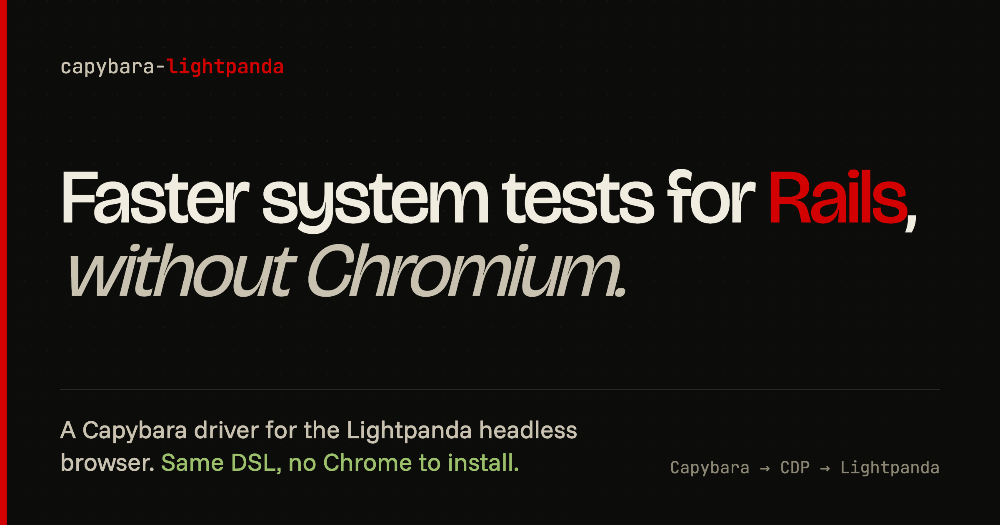

<div align="center">

# Capybara::Lightpanda

[](https://rubygems.org/gems/capybara-lightpanda)
[](https://rubygems.org/gems/capybara-lightpanda)
[](https://github.com/navidemad/capybara-lightpanda/actions/workflows/ci.yml)
[](https://github.com/navidemad/capybara-lightpanda/actions/workflows/real-apps.yml)

A [Capybara](https://github.com/teamcapybara/capybara) driver for [Lightpanda](https://lightpanda.io/), the fast headless browser built in Zig.<br>
Self-contained — built-in CDP client, no external browser-client gem required.

<strong>Capybara</strong>&nbsp;&nbsp;→&nbsp;&nbsp;<code>capybara-lightpanda</code>&nbsp;&nbsp;→&nbsp;&nbsp;<a href="https://lightpanda.io/"></a>&nbsp;<a href="https://github.com/lightpanda-io/browser/stargazers"></a>

[](https://navidemad.github.io/capybara-lightpanda/)

**[Documentation](https://navidemad.github.io/capybara-lightpanda/docs/)** — configuration · setup recipes · Turbo Rails · known limitations · troubleshooting

</div>

## Why

Same Capybara DSL, no Chromium to install, boot or keep in memory. On a Rails 8.1 app (Turbo + Stimulus, 24 DOM-only system tests, M-series laptop):

| Driver | Tests | Time | RSS / worker |
|---|---|---|---|
| **Lightpanda** | 24 / 24 | 6.89s | **~17 MB** |
| Chrome | 24 / 24 | 7.09s | ~280 MB |

Wall-clock is close on a small suite — Capybara's own waiting dominates. The gain is memory: more parallel workers on the same CI runner, and no Chromium boot to flake. The driver is also run weekly against the specs of seven production Rails apps (Forem, Solidus, Spree, Decidim, Campfire, Mastodon, alonetone) — [results and known failures](https://navidemad.github.io/capybara-lightpanda/docs/#validation).

## Requirements

| | |
|---|---|
| **Ruby** | ≥ 3.3 — CI covers 3.3 and 4.0 |
| **Capybara** | ≥ 3.0, < 5 |
| **Platforms** | Linux `x86_64` (glibc ≥ 2.35) · Linux `aarch64` (glibc ≥ 2.38) · macOS Apple Silicon · macOS Intel · Windows through WSL2 (no native Windows build upstream) |

An unsupported host raises `UnsupportedPlatformError` at boot, naming what it detected — it never fails halfway through a suite.

> [!NOTE]
> The glibc minimums come from Lightpanda's release binaries. Debian 12 and Ubuntu 22.04 on **arm64** ship glibc < 2.38 and can't run them — use Ubuntu 24.04 / Debian 13, or point `browser_path` at a binary you built.

## Install

Add this to your `Gemfile` and run `bundle install`:

```ruby
group :test do
  gem "capybara-lightpanda"
end
```

The driver registers itself as `:lightpanda`, and the Lightpanda binary is downloaded on first use — no separate install step.

**Rails system tests**

```ruby
# test/application_system_test_case.rb
require "test_helper"
require "capybara-lightpanda"

class ApplicationSystemTestCase < ActionDispatch::SystemTestCase
  driven_by :lightpanda
end
```

**RSpec, or Capybara on its own**

```ruby
# spec/support/capybara.rb
require "capybara-lightpanda"

Capybara.javascript_driver = :lightpanda

# rspec-rails system specs don't read javascript_driver either:
RSpec.configure do |config|
  config.before(:each, type: :system) { driven_by :lightpanda }
end
```

## Configure

Every option has a working default; set only what you need:

```ruby
Capybara::Lightpanda.configure do |config|
  config.window_size = [375, 812] # what @media / matchMedia evaluate against (default 1920×1080)
  config.timeout = 30             # per-command and navigation timeout, in seconds (default 15)
end
```

All options are listed under [Configuration](https://navidemad.github.io/capybara-lightpanda/docs/#configuration).

> [!TIP]
> The gem downloads the Lightpanda release it was validated against (currently 1.0.4), so the browser only changes when you upgrade the gem. If your suite stubs HTTP (VCR/WebMock), run `bundle exec capybara-lightpanda install` in `bin/setup` and in CI before the tests. To pick another release or the rolling nightly, see [Choosing the browser version](https://navidemad.github.io/capybara-lightpanda/docs/#pinning).

## What won't pass

Lightpanda is a headless browser without a layout engine. External stylesheets are fetched and applied, and `@media` / `matchMedia` resolve at the `window_size` you configure — but nothing reflows. Specs that depend on any of these can't pass here:

- pixel geometry (`getBoundingClientRect` is synthetic)
- real scrolling
- screenshots
- a second browser tab or window
- a menu revealed purely by CSS `:hover`

See [known limitations](https://navidemad.github.io/capybara-lightpanda/docs/#limits) for the full list.

## Examples

Runnable single-file Rails demos live in [`examples/`](examples/): [Minitest](examples/rails_minitest_example.rb), [RSpec](examples/rails_rspec_example.rb), Turbo Drive + Frames ([Minitest](examples/rails_turbo_minitest_example.rb) · [RSpec](examples/rails_turbo_rspec_example.rb)), and a [click-to-open dropdown](examples/rails_dropdown_minitest_example.rb).

## Upgrading

A gem release can raise the minimum Lightpanda version it accepts; the driver refuses an older browser and names the version it found. Read [CHANGELOG.md](CHANGELOG.md) before bumping.

## Credits

- [Lightpanda](https://lightpanda.io/) — the headless browser
- [Capybara](https://github.com/teamcapybara/capybara) — the test framework
- Inspired by the [Ferrum](https://github.com/rubycdp/ferrum) architecture and [`lightpanda-ruby`](https://github.com/marcoroth/lightpanda-ruby)

Patterns adapted from these MIT-licensed projects (cookies API, frame switching, node call/error conventions, retry/event utilities) are acknowledged with the original copyright notices in [NOTICE.md](NOTICE.md).

## Contributing

Bug reports and pull requests are welcome on [GitHub](https://github.com/navidemad/capybara-lightpanda).<br>
For beta-testing tips and how to file useful feedback, see [BETA_TESTING.md](BETA_TESTING.md).

## License

[MIT License](LICENSE.txt)
