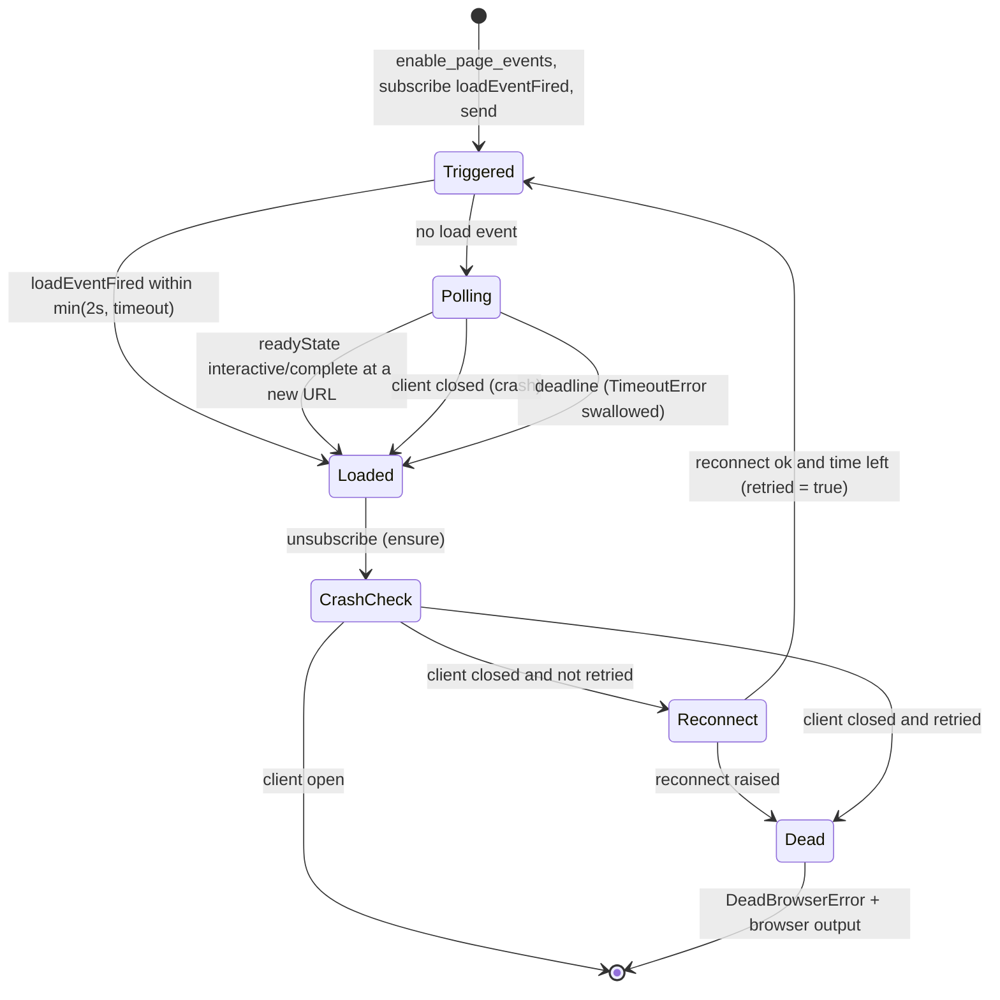

# State machines

Every stateful part of the driver, explicit (a `@status` symbol) or implicit (flags, events, buffers that only make sense together). For each one: its states, the invariants that must hold, and its transitions. **Violated** marks an invariant the code breaks today. **Defects** lists the invalid states or transitions the code could actually reach, with evidence and the issue that tracks them.

Paths are relative to `lib/capybara/lightpanda/`. Symbols are named instead of line numbers, so references don't go stale. Audited 2026-11-08 at `104b3d0` against Lightpanda 1.0.3.

Threads involved:

- **main**: the test, plus Capybara's server thread when a request handler calls back into the driver.
- **reader** (`WebSocket#start_reader_thread`): parses socket bytes into `@messages`.
- **dispatch** (`Client#start_message_thread`): resolves command replies and runs every `on(...)` callback. Every CDP event handler below runs here, never on main.
- **drain** (`Process#start_drain_thread`): copies the browser's stdout and stderr into `Process#output`.

## Contents

1. [Process](#1-process): spawned binary lifecycle
2. [WebSocket transport](#2-websocket-transport): `@status`
3. [Client command](#3-client-command): one CDP request
4. [Browser session](#4-browser-session): context, target, subscriptions, buffers
5. [Driver browser slot](#5-driver-browser-slot): respawn and reset
6. [Navigation tracking events](#6-navigation-tracking-events): context, navigation, document-ready
7. [`go_to` / `refresh`](#7-go_to--refresh-await_navigation): `await_navigation`
8. [`wait_for_idle`](#8-wait_for_idle-after-click--send_keys--submit--back--forward): after click, send_keys, submit, back, forward
9. [Turbo activity](#9-turbo-activity-javascriptsturbojs--turbo_event): `turbo.js` + `@turbo_event`
10. [Modal pre-arm](#10-modal-pre-arm-browsermodals)
11. [Network traffic entry](#11-network-traffic-entry-and-tracker): one request, plus tracker enablement
12. [Downloads](#12-downloads)
13. [Frame stack](#13-frame-stack-and-frame-scoped-nodes)
14. [Keyboard modifiers](#14-keyboard-modifiers-one-type-call)
15. [Defects](#defects): status and issues

---

## 1. Process

`process.rb`. Implicit states derived from `@pid`, the OS state of that pid, and `@ws_url`.

| State | `@pid` | OS | Meaning |
|---|---|---|---|
| Idle | nil | none | Never started, or stopped |
| Starting | set | running | Spawned, `wait_for_ready` scanning output for `READY_PATTERN` |
| Running | set | running | `@ws_url` known, drain thread started |
| Exited | set | zombie until reaped | Crashed or killed; nothing has called `waitpid` yet |

| From | Event | To | Code |
|---|---|---|---|
| Idle | `start` | Starting | `attempt_start` → `spawn_process`, `register_finalizer` |
| Starting | ready line | Running | `wait_for_ready` sets `@ws_url`, then `start_drain_thread` |
| Starting | "address in use" | Idle, then one retry | `stop` + `PortInUseError` → `kill_process_on_port` → `attempt_start` |
| Starting | `process_timeout` | Idle | `stop` + `ProcessTimeoutError` |
| Running | crash or signal | Exited | (external) |
| Running / Exited | `stop` | Idle | `terminate` (TERM, then KILL after `STOP_GRACE_SECONDS`, then reap), `cleanup_pipes` |
| any | GC finalizer | (process gone) | `weak_kill` → `terminate` |

Invariants:

- `alive?` is true only in Starting/Running. An Exited child must read as dead: `restart_process_if_dead` depends on it. **Violated:** see D2.
- Exactly one finalizer per instance, aimed at the latest pid (`register_finalizer`).
- `stop` is safe in any state and on an already-reaped pid (`reap_within` treats `ECHILD` as reaped).

## 2. WebSocket transport

`client/web_socket.rb`. Explicit: `@status ∈ {:closed, :open, :closing, :error}`. `:closed` is both the initial (connecting) state and the final one.

| From | Event | To | Code / thread |
|---|---|---|---|
| `:closed` (initial) | handshake done | `:open` | `@driver.on(:open)` during `read_handshake_response` (main) |
| `:closed` (initial) | handshake EOF / timeout | (raise) | `DeadBrowserError` / `TimeoutError` from `connect` |
| `:open` | peer close frame | `:closed` | `on(:close)` → `mark_dead` (reader) |
| `:open` | protocol error | `:error` | `on(:error)` → `mark_dead(:error)` (reader) |
| `:open` | EOF / `ECONNRESET` / `EPIPE` | `:closed` | reader rescue → `mark_dead` |
| `:open` | unexpected reader error | `:error` | reader rescue → `mark_dead(:error)` |
| `:open` | write stalled past deadline | `:error` | `abandon_stalled_write` (caller thread) |
| `:open` | dispatch thread died | `:error` | `Client#start_message_thread` → `mark_dead(:error)` |
| `:open` / `:error` | `close` | `:closing` → `:closed` | `close` (main) |
| `:closed` | `close` | `:closed` | `close_socket` only |

Invariants:

- **Dead implies the queue is closed.** Every path into `:closed`/`:error` goes through `mark_dead`, which sets the status *before* closing `@messages`. A woken waiter therefore already sees `closed?`.
- `send_message` requires `:open`, and every frame write and parse holds `@driver_mutex`.
- `closed?` covers every state in which no reply can still arrive. **Violated:** `:closing` reads as open, see D6b.
- `close` always completes and releases the socket, even when writing the close frame fails. **Violated:** see D6c.

## 3. Client command

`client.rb#command`. One `Concurrent::IVar` in `@pendings[id]`.

| From | Event | To |
|---|---|---|
| — | `command` (sync) | Pending (registered **before** the send) |
| Pending | reply with `id` | Resolved → result, or `handle_error` raises |
| Pending | duplicate reply | Resolved (`try_set` ignores the duplicate) |
| Pending | deadline passes | TimedOut → `TimeoutError` |
| Pending | transport dies / `close` | Released (`nil`) → `DeadBrowserError` |
| any | `ensure` | removed from `@pendings` |

Invariants:

- One deadline covers lock wait, write and reply (`Utils::Wait.deadline`).
- Registering before sending means a reply can never beat its IVar. `mark_dead` sets the status before `fail_pending_commands` runs, so a command registered after the release still fails fast on `send_message`'s `:open` check.
- A `nil` reply means the connection is gone, and the error must say so (`DeadBrowserError`). **Violated** during `close`: see D6b.

## 4. Browser session

`browser.rb`. Implicit state spread across `@started`, `@client`, `@process`, `@browser_context_id`, `@target_id`, `@session_id`, the subscriber list, and the flags `@page_events_enabled` and `@modal_handler_installed`.

| State | Holds |
|---|---|
| New | nothing (inside `initialize` before `start`) |
| Started | client open, context, target, session, every `create_page` subscription |
| Disposed | context/target/session nil, subscriptions cleared (inside `reset`, between dispose and create) |
| Quit | client nil, process nil, `@started` false, untracked |

| From | Event | To | Code |
|---|---|---|---|
| New | `start` ok | Started (tracked for `at_exit`) | `start` |
| New | `start` raises | **leaks** the process and client (D3) | exception escapes `start` |
| Started | `reset` | Disposed → Started | `dispose_browser_context`, `clear_subscriptions`, `clear_session_state`, `create_browser_context`, `create_page` |
| Started | crash mid-`go_to` | Started (new client and context) | `handle_navigation_crash` → `reconnect` |
| Started | `quit` | Quit | `quit` |
| Quit | `start` | Started | `start` (supported reuse, see `quit`'s comment) |

Invariants:

- Every `on(...)` subscription belongs to the current `@client`. `reset` clears them before `create_page` re-adds them, and `reconnect` gets them fresh with the new client.
- Per-session buffers (console, page errors, modal queue, frames, Network, Downloads) are wiped whenever the context is replaced (`clear_session_state`).
- `@page_events_enabled` mirrors whether `Page.enable` was sent **on the current connection**. `quit` does not reset it. Lightpanda 1.0.3 still delivers Page events on the reused connection (dialogs and navigations were observed after `quit` → `start`), so this has no visible effect. It is a latent risk: see L1.
- A Browser that failed to start must leave no process and no socket behind. **Violated:** see D3.

## 5. Driver browser slot

`driver.rb`. `@browser ∈ {nil, alive Browser, dead Browser}`.

| From | Event | To | Code |
|---|---|---|---|
| nil | any call through `browser` | alive | `Browser.new` |
| alive | transport dies | dead | (detected lazily by `browser_alive?`) |
| dead | any call through `browser` | alive (new instance) | `browser` drops the dead one **without `quit`** (D3) |
| alive | `reset!` ok | alive | `Browser#reset` |
| alive | `reset!` raises a gem/IO error | nil | `quit` + nil |
| any | `quit` | nil | `Browser#quit` |

Invariants:

- At most one Lightpanda process per driver.
- A replaced browser is always quit, so its process is stopped (TERM, then KILL) and it is untracked. **Violated:** see D3.

## 6. Navigation tracking events

`browser.rb`, `subscribe_to_execution_context` / `subscribe_to_navigation` / `subscribe_to_document_ready`. Three `Utils::Event`s, recreated by every `create_page`. *Set* means settled; `reset` bumps the iteration counter.

| Event | Reset by | Set by |
|---|---|---|
| `@default_context_event` | `Runtime.executionContextsCleared` | `executionContextCreated` with `isDefault` |
| `@navigation_event` | main-frame, cross-document `Page.frameStartedNavigating` | main frame's new default context, main-frame `frameStoppedLoading`, `loadingFailed` for the main Document request |
| `@document_ready_event` | same as navigation | `domContentEventFired`, `loadEventFired`, main-frame `frameStoppedLoading`, main Document `loadingFailed` |

Invariants:

- Each event starts set (an idle page has nothing to wait for).
- Same-document navigations and iframe navigations never reset `@navigation_event` (`main_frame_navigation_start?` checks `frameId == @target_id` and skips `same*` types).
- A refused or failed main navigation must still set both navigation events: `loadingFailed` keyed by `@navigation_request_id`.

## 7. `go_to` / `refresh` (`await_navigation`)

`browser/navigation.rb`.

Invariants:

- One deadline for the whole navigation, so the worst case is 1× timeout.
- At most one reconnect per `go_to` (the `retried:` flag).
- `reconnect` restarts the process only when it is really gone. That needs `Process#alive?` to treat a zombie as dead. **Violated:** see D2.
- A transport already dead **before** `go_to` raises `DeadBrowserError` from the send. This path is not recovered here: `Driver#browser` respawns on the next call.

## 8. `wait_for_idle` (after click, send_keys, submit, back, forward)

`browser.rb#wait_for_idle`. Runs on main and reads iteration counters that the dispatch thread bumps.

| Phase | Exit when | Next |
|---|---|---|
| Sniff (≤ `SNIFF_WINDOW` = 50 ms) | navigation iteration grew | Navigating |
| Sniff | context iteration grew | Settle |
| Sniff | window elapsed | Settle |
| Navigating | `@navigation_event` set (≤ timeout) | DocumentReady |
| DocumentReady | `@document_ready_event` set (≤ 2 s), else readyState polling | Settle |
| Settle | `@default_context_event` set, then `@turbo_event` set (each ≤ timeout) | ModalCheck |
| ModalCheck | `check_unhandled_modal!` | done |

Invariants:

- Only a navigation this action started is awaited (comparison against the prior iteration).
- No phase can wait on a signal that will never come, or the action pays the full timeout every time. The Turbo phase depends on §9 settling (D1, fixed).

## 9. Turbo activity (`javascripts/turbo.js` + `@turbo_event`)

JS side: a per-document counter `_pendingTurboOps`. It emits a `__lightpanda_turbo_busy` sentinel on 0 → 1 and `__lightpanda_turbo_idle` on 1 → 0. Ruby side: `@turbo_event` is reset on busy, and set on idle or on `executionContextsCleared`.

| Operation | Starts on | Ends on |
|---|---|---|
| fetch | `turbo:before-fetch-request` | the first of: `turbo:before-fetch-response` or `turbo:fetch-request-error` for its target, or `abort` on its `fetchOptions.signal` (once per fetch, via a token) |
| form submission | `turbo:submit-start` | `turbo:submit-end` |
| frame render | `turbo:before-frame-render` | `turbo:frame-render` |
| stream render | `turbo:before-stream-render` | wrapped `render` returns or settles |
| (reset) | `turbo:load` | counter := 0, open fetch tokens dropped, idle re-signalled |

Invariants:

- Every operation that starts must end exactly once, whatever way it ends. An aborted fetch fires neither response nor error event (Turbo swallows `AbortError`), so the abort signal is what ends it (D1, fixed).
- The counter never goes below zero (`_turboEnd` guard). A fetch never ends twice (`token.open`).
- A navigation always re-arms the Ruby event (`executionContextsCleared` → set): a new document has a new counter.

## 10. Modal pre-arm (`browser/modals.rb`)

Two cooperating slots plus a queue:

- Lightpanda's `target.pending_dialog_response`: one slot, filled by `LP.handleJavaScriptDialog` and consumed by the next dialog.
- Ruby's `@modal_armed`, mirroring that slot.
- `@modal_messages`: dialogs waiting to be claimed by `find_modal`.
- `@unhandled_modal`: the first dialog that opened with nothing armed.

| From | Event | To |
|---|---|---|
| Idle | `accept_modal` / `dismiss_modal` | Armed. LP slot filled, `@modal_armed`. Older queued dialogs **kept** (D4a) |
| Armed | dialog opens | Idle. Slot consumed on both sides, entry queued |
| Idle | dialog opens (unwrapped) | Idle. Entry queued, `@unhandled_modal` recorded |
| any | `find_modal` claims a matching entry | returns its message |
| Armed | `find_modal` times out | **stays Armed** on both sides, then `ModalNotFound` (D4b) |
| any | `check_unhandled_modal!` | `@unhandled_modal` cleared, then warn or `UnhandledModalError` |
| any | `clear_session_state` | everything cleared |

Invariants:

- `@modal_armed` ⇔ the LP slot holds a response that Capybara asked for.
- `find_modal` only returns a dialog that opened after its own arm.
- A dialog nobody wrapped is reported (warning or `UnhandledModalError`) and gets Lightpanda's default answer, never a stale pre-arm.
- `@modal_messages` and `@modal_armed` are only touched under `@modal_messages_mutex` (they are written on dispatch and read on main).

## 11. Network traffic entry and tracker

`network.rb`.

Tracker: `@enabled` false ⇄ true, together with the handler triple (`subscribe`/`unsubscribe`). `enable` subscribes before sending `Network.enable` and rolls back on failure. `disable` sends first, then unsubscribes. `reset` wipes state without any CDP call (the context is already gone).

Entry: Open (`response` and `error` both nil) → Responded | Failed | Redirected (closed by the next hop's `redirectResponse`).

Navigation capture: `@document_request_id` follows **any** Document request, iframes included (D5). `@last_navigation_response` is cleared when that request starts and filled by its response.

Invariants:

- Every entry ends: a response, a `loadingFailed`, or the next redirect hop. Otherwise `pending_connections` stays above zero and every `wait_for_idle` burns its whole timeout.
- The buffer is capped at `TRAFFIC_LIMIT`.
- `@enabled` is true ⇔ the handlers are subscribed on the current client.
- `status_code`/`response_headers` describe the top-level document only. **Violated:** iframe Document requests overwrite them, see D5.

## 12. Downloads

`downloads.rb`. Tracker: disabled → enabled (only with a save path) → reset. Per download (`guid`): Pending (`downloadWillBegin`) → Completed (path appended to `@files`) | Canceled. `@started` grows monotonically so `wait` can tell that a download began even after the queue drained.

Invariants:

- `@pending` only holds downloads that began and have not finished.
- `reset` drops the handlers and the counters together with the disposed context.

## 13. Frame stack and frame-scoped nodes

`browser.rb#frame_stack`. `switch_to_frame(Node)` pushes, `:parent` pops, `:top` clears. `clear_session_state` and `quit` also clear it. A `Node` found while the stack is non-empty is built `frame_scoped:`, so `Node#call` also checks that its frame document is still the current one.

Invariant: the stack never outlives the context its nodes came from. Every context replacement clears it.

## 14. Keyboard modifiers (one `type` call)

`keyboard.rb`. `active_mods` grows with each modifier `keyDown`, and `release_modifiers` sends a `keyUp` per held modifier in reverse order. Nested arrays have their own scope (`type_with_modifiers`).

Invariant: every modifier `keyDown` gets its `keyUp`, even when a key in the chord raises. **Violated:** see D6a.

---

## Defects

Ranked by impact. Evidence comes from probes against Lightpanda 1.0.3 through the real driver, unless marked as code reading.

| ID | Impact | Machine | Invalid state or transition | Evidence | Issue | Status |
|---|---|---|---|---|---|---|
| D1 | High | §9 Turbo, §8 | An aborted Turbo fetch never decrements the counter, so Busy is stuck. Every later click / send_keys / back waits the full timeout | `turbo:before-fetch-request` with no response or error event; two plain clicks took 10.06 s each with `timeout: 10` | [#218](https://github.com/navidemad/capybara-lightpanda/issues/218) | fixed: `turbo.js` fetch tokens; `test/js/turbo.test.ts`, `test/features/turbo_abort_test.rb` |
| D2 | High | §1 Process, §7 | An exited, unreaped child reads as alive, so `reconnect` never restarts a browser that crashed mid-navigation and raises `DeadBrowserError` instead | `kill -9` then `process.alive?` → `true`; `kill(0)` succeeds on a zombie | [#219](https://github.com/navidemad/capybara-lightpanda/issues/219) | open |
| D3 | High | §5 Driver, §4 | A dead browser is replaced without `quit`, so its process keeps running and stays tracked. A failed `start` leaks its process and CDP connection | 2 `lightpanda serve` processes after a respawn, old one alive and tracked; `start` has no cleanup (code reading) | [#219](https://github.com/navidemad/capybara-lightpanda/issues/219) | open |
| D4a | Medium | §10 Modal | A dialog queued before the arm satisfies `find_modal`, so `accept_*` passes when its block opened nothing | `accept_alert { noop }` returned `"first"` from an earlier unwrapped alert | [#220](https://github.com/navidemad/capybara-lightpanda/issues/220) | open |
| D4b | Medium | §10 Modal | Armed survives `ModalNotFound`, so the next unwrapped dialog gets the stale answer silently | unwrapped `confirm` returned `true` with no warning after a failed `accept_confirm` | [#220](https://github.com/navidemad/capybara-lightpanda/issues/220) | open |
| D5 | Medium | §11 Network | An iframe's Document request becomes "the navigation", so `status_code` reports the iframe | page 200 with a 404 iframe → `status_code == 404` | [#221](https://github.com/navidemad/capybara-lightpanda/issues/221) | open |
| D6a | Low | §14 Keyboard | A raising key leaves held modifiers down (`keyDown` with no `keyUp`) | `type` has no `ensure` (code reading) | [#222](https://github.com/navidemad/capybara-lightpanda/issues/222) | open |
| D6b | Low | §2/§3 | `:closing` is not `closed?`, so commands released by `close` raise `TimeoutError` instead of `DeadBrowserError` | `Client#command` checks `@ws.closed?` (code reading) | [#222](https://github.com/navidemad/capybara-lightpanda/issues/222) | open |
| D6c | Low | §2 | A stalled close-frame write raises out of `WebSocket#close`, so `Client#close` skips its teardown | `abandon_stalled_write` raises from `@driver.close` (code reading) | [#222](https://github.com/navidemad/capybara-lightpanda/issues/222) | open |

### Latent, not fixed

- **L1**: `quit` keeps `@page_events_enabled`, so `quit` → `start` reuse never re-sends `Page.enable`. On 1.0.3 the reused connection still delivers Page events (probe: `accept_alert` worked after `quit` → `start`), so nothing breaks today. Fix it if a Lightpanda build starts gating Page events on `Page.enable`.

### Checked and found sound

- Command-id allocation, IVar registration order and duplicate replies (§3).
- Redirect hops and `loadingFailed` closing traffic entries (§11).
- `Utils::Event` iteration guards in `wait_for_idle` (§8).
- `Network#enable` / `Downloads#enable` rollback on failure.
- The `retried:` bound on navigation crash recovery (§7).
- `reset` failure handling in `Driver#reset!`.
